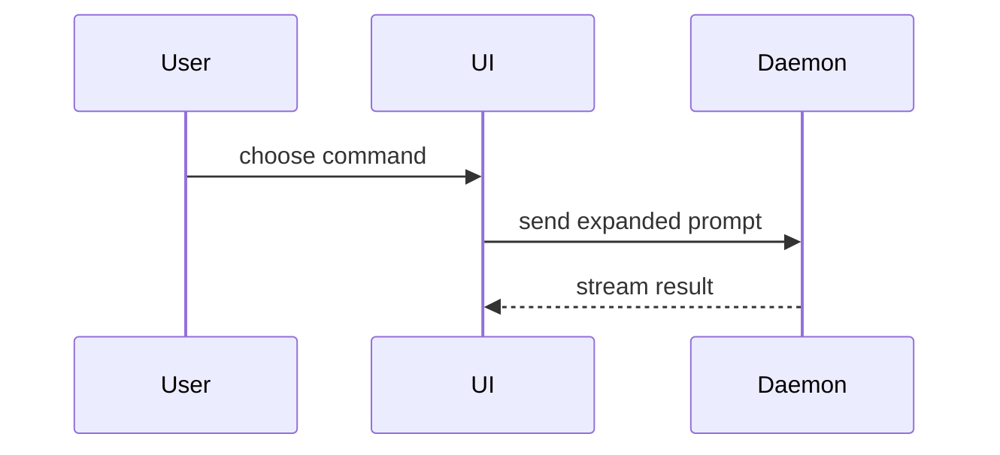

> Local notes: if `~/.agents/skill-notes/show-me.md` exists, read it first. It holds this setup's private facts for this skill (names, brands, paths, house rules) and wins over the generic text here.

Help the user understand the current topic of conversation visually. Skip the preamble and keep prose brief. Pick the smallest view that makes the key point clear.

## Find the subject first

Before drawing, find the thing you are drawing. Look nearest first and stop as soon as you have it:

1. The conversation and the working folder (`ls`, `grep -ril <name> .`).
2. This skill's own plugin and the marketplace clone it was installed from. The skill's base
   folder is printed when the skill loads. The marketplace clone is five folders up from it, in
   `marketplaces/` (`<base>/../../../../../marketplaces/*/`), or in
   `~/.claude/plugins/marketplaces/` (`$CLAUDE_CONFIG_DIR/plugins/marketplaces/` when that is
   set). It holds the repo's own docs, for example `AGENT-SETUP.md` in steven-skills.
3. The home folder, with a bounded search:
   `find ~ -maxdepth 4 -iname '*<name>*' -not -path '*/node_modules/*' -not -path '*/.git/*'`.

Never search the whole disk (`find /`). Still not found: draw what you have, and say in one line
what you could not find. Do not stop to ask which one was meant.

**A picture means a drawing.** When the user asks for a picture, a diagram, a drawing, or "how X works" visually, draw boxes and arrows: a Mermaid `flowchart` or `sequenceDiagram`, or an HTML/SVG figure. A numbered list of steps, a bullet outline or a file tree is not a picture, even inside a code block. Keep it to 8 boxes or fewer, label every arrow with what moves along it, and add a key for any symbol or color. If the user wants a crafted, detailed figure of a system rather than a quick sketch, and a figure skill such as anatomy is installed, hand over to it.

- Show logic or an algorithm as pseudocode:

```text
on(save)
  if content is unchanged
    return cached result
  write new content
  return fresh result
```

- Show runtime control flow as a call tree:

```text
submitForm
  createSession
    persistPrompt
    launchAgent
  navigateToSession
```

- Show UI structure as a component tree, including state and module boundaries that matter:

```tsx
<SessionPage> (apps/example/src/routes/session.tsx)
  useSessionEvents()
  <SessionToolbar>
    <RunSkillButton> (packages/ui)
```

- Show file responsibility or a broad refactor as a shallow file tree:

```text
src/
├── commands/       # parses user actions
├── sessions/       # owns session state
└── transport/      # sends API requests
```

- Show component interaction, control flow, or data flow with Mermaid:



- Use `diff` when the point is what changes and the surrounding shape already exists. Match the diff shape to the topic.

For a component change:

```diff
 <SessionPage>
   useSessionEvents()
   <SessionToolbar>
+    <RunSkillButton />
   <SessionTimeline>
+    <SkillResultCard />
```

For a file-layout change:

```diff
 src/
 ├── commands/
+│   └── show-me.ts       # expands the slash command
 ├── sessions/
-└── transport.ts
+└── transport/
+    ├── client.ts
+    └── stream.ts
```

For a call-tree or call-stack change:

```diff
 submitForm
   createSession
     persistPrompt
+    expandSkillMention
     launchAgent
-  navigateToSession
+  navigateToSession
+    subscribeToEvents
```

For a state or control-flow change:

```diff
 on(save)
-  write content
+  if content is unchanged
+    return cached result
+  write new content
+  invalidate cache
```

- Show the whole block when most of it is new, when omitted context would hide ownership or order, or when the user needs a copyable target shape:

```ts
function expandSkill(command: string): string {
  const skillName = command.slice(1)
  return `use the ${skillName} skill`
}
```

- For a visual UI, layout, state comparison, or concept too dense for Mermaid, write one focused HTML file, a diagram, an infographic, or a short slide deck, whichever fits the point. Use real labels and data; support desktop and mobile. Then open it for the user:

```
Bash(open path/to/show-me-{description}.html)
```

- **Design before you show.** Any HTML visual goes through the `design-apply` skill (design plugin) first: it picks a design system (the product's brand, else the library match for the page's purpose), you build with its tokens, and its automatic check must pass before the user sees the page. Lean on type, space and one accent. The drawing itself is boxes and arrows (8 or fewer); the page around it is not: no bordered card per section or step, no code chip in every line. Without the design plugin, follow the same leanings and match the product's colors, type and spacing.

- Place each visual next to the short text it supports. Keep only the calls, files, props, states, and boundaries needed to answer the user's current question.

You may use one of these, you may use several, it is unlikely you will use all of them. Use your judgement and don't overwhelm the user.

## Business topics

For a client's business (not code), pick the format by the shape of the idea: a rule with
numbers gets a calculator, a job someone does gets a game, how the parts fit gets a 3D
scene, one tricky idea gets an animated explainer (Manim or Remotion), a process gets a
Remotion video, the big picture on the go gets an audio overview. When a topic has three or
more connected parts, build a visual without being asked.

Start from a template in `templates/`. Each is one HTML file, light and dark, no build step.
Edit the data object at the top; use real names and numbers only.
Each template carries a `<style id="tokens">` slot as its first style element; to restyle it,
replace that slot's contents with the chosen system's `tokens.css`.

Never ship the plain default look. Dress the page with `design-apply`: for a map or diagram
it usually picks control-room, for a calculator explorable, for a game playground, for a
story editorial (these four used to live in this skill's `styles/` folder and are now
systems in the design library). Pull one fresh reference and vary type, accent or layout so
no two pages look cloned. Blend in the client's product brand when the lesson is about
their product. Add motion and interaction by default and redraw the layout for the phone.
Run the check before showing.

- `game.html`: the learner plays a person in the business. Intro screen, levels, score, a "why"
  card with the real rule after each mistake, and quips for a light tone.
- `calculator.html`: sliders and inputs, a live result, and one sentence that explains the rule
  with the current numbers.
- `scene-3d.html`: Three.js from a CDN. Labelled boxes, edges, and dots flowing along them in
  the direction things move. Drag to orbit; click a name to read what it does.

Save the result where the project keeps its learning material and open it in a browser to check
it renders before showing it.

## Look at it before you report

Every picture gets checked by eye before you say it is done. Never report a diagram you have
not seen rendered.

1. Render it to an image. For an HTML or SVG file, take a screenshot with a browser tool or
   headless Chrome (`chrome --headless --screenshot=out.png --window-size=1280,900 file.html`;
   on macOS the binary is `/Applications/Google Chrome.app/Contents/MacOS/Google Chrome`).
   For Mermaid, render it (`npx -y @mermaid-js/mermaid-cli -i in.mmd -o out.png`) or put it in
   a small HTML page and screenshot that.
2. Open the PNG and look at it. Check: it is boxes and arrows, not a list; every label is
   readable and inside its box; no arrow points at nothing. Then trace the flow from the first
   box to the last: every step has a visible arrow to the next one, including where a row
   wraps to the next line. A missing or hidden arrow is a failure, not a minor flaw. Fix it (one
   row, a vertical flow, or a drawn wrap connector) before you report. For an HTML page, also take one
   screenshot at phone width (`--window-size=390,844`) and one per theme when the page has
   light and dark, and look at each.
3. For an HTML page, also run `design-apply`'s check (`scripts/check.mjs` in that skill) and fix every fail.
4. Fix what is wrong and look again. Never report a flaw you saw as accepted. Say in your reply that you checked the render, and show
   or link the screenshot.
